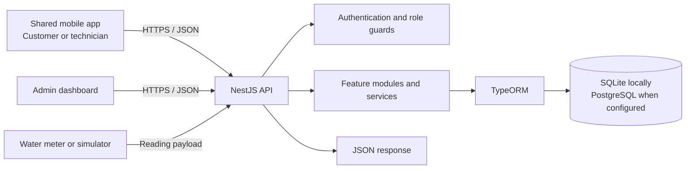
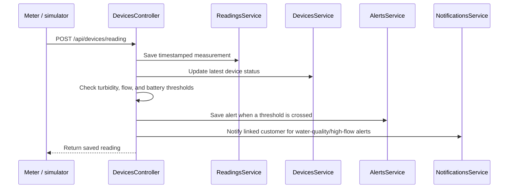

# Backend Presentation Guide

This guide explains the Smart Water Management backend in presentation language. It describes the implementation in this repository, including prototype limitations.

## 1. Backend in one sentence

The backend is the central API for the AquaSense system: it authenticates users, connects mobile and admin clients to water meter data, stores customer and service records, and turns sensor readings into alerts and notifications.

## 2. System overview

There is one API for the clients. The login response contains a role, so the shared mobile app opens the customer or technician experience after sign-in. The admin dashboard uses admin-only API routes. Devices send sensor readings to the ingestion route.

## 3. How the code is organized

The project uses a common NestJS pattern:

1. **Controller:** receives an HTTP request and returns the response. Examples: `auth.controller.ts`, `devices.controller.ts`.
2. **Guard:** checks whether the request has a valid login token and whether the account role is allowed.
3. **Service:** runs the application rules, such as assigning a ticket or evaluating a sensor threshold.
4. **Entity and repository:** map stored records to database tables through TypeORM.

`src/main.ts` starts the server, enables CORS, and installs a global validation pipe for DTO classes where they are used. It does not automatically validate every inline or `any` request body. `src/app.module.ts` imports the feature modules. The feature modules divide the API by business function rather than putting all routes in one file.

| Feature | What to say in the presentation |
| --- | --- |
| `auth` | Signs users in and creates JWTs containing their identity and role |
| `customers` / `technicians` | Stores customer and staff account details |
| `devices` / `readings` | Tracks meters, receives readings, and stores usage history |
| `alerts` / `notifications` | Records threshold events and informs affected accounts |
| `support-tickets` | Connects customer requests to technician work and status updates |
| `billing` / `payments` | Stores water bills and payment records |
| `audit` | Stores admin activity log entries |

## 4. Main data concepts

The important database records are:

- **Customer:** name, email, password hash, address, role, and optional meter ID.
- **Technician:** work account, status, service zone, specialization, and workload counters.
- **Device:** unique meter number, customer link, current valve/connectivity state, and battery level.
- **Reading:** timestamped flow, total usage, turbidity, valve, connectivity, and battery values.
- **Alert:** a warning associated with a meter, such as high turbidity or flow.
- **Support ticket:** customer request, assigned technician, priority, status, and resolution notes.
- **Bill and payment:** amounts and status associated with a customer.
- **Notification:** message for a specific account and audience, with a read flag.

Records are logically connected by account IDs and meter IDs. For example, a customer's JWT contains the linked meter ID, and the customer dashboard uses that ID to fetch the meter's readings.

## 5. Three end-to-end flows to present

### A. Sign-in and dashboard routing

1. The mobile app sends email and password to `POST /auth/login`.
2. `AuthService` looks for a customer, then a technician, and checks the submitted password against the stored bcrypt hash.
3. The backend returns a signed JWT and a user object that includes the role.
4. Protected requests send the token in `Authorization: Bearer <token>`.
5. `JwtAuthGuard` validates the token. `RolesGuard` restricts routes such as technician tickets to technicians and admin routes to administrators.
6. The mobile app reads the role and opens the matching dashboard.

The access token currently expires after seven days.

### B. Meter reading to alert

The current demo thresholds are turbidity above `5 NTU`, flow above `30 L/min`, and battery below `15%`. These are configurable project rules, not universal water-quality standards. Water-quality and high-flow alerts notify the linked customer; low-battery readings currently create an alert without a customer notification.

### C. Customer request to technician work

1. A customer creates a support ticket in the mobile app. A customer without a meter can submit a `Water Meter Request` with an address and contact number.
2. `SupportTicketsService` saves the request and assigns it to an available technician when one is available.
3. The backend sends notifications to the technician and customer.
4. The technician reads only tickets assigned to their account, then accepts, rejects, or resolves the work.
5. A status update is stored with its history and the customer is notified.

The customer and technician views are different role-based views of the same stored ticket.

## 6. API routes to put on a slide

| Route | Main purpose | Access |
| --- | --- | --- |
| `GET /health` | Service health check | Public |
| `POST /auth/login` | Sign in and receive token/role | Public |
| `POST /auth/register` | Create customer account and optionally link a meter | Public |
| `GET /api/mobile/home` | Customer's dashboard data | Authenticated |
| `GET /api/mobile/readings/daily` | Customer's usage history | Authenticated |
| `POST /api/mobile/support-tickets` | Customer support or meter request | Customer |
| `POST /api/mobile/valve` | Control linked meter valve | Authenticated customer |
| `GET /api/technician/home` | Technician work summary | Technician |
| `GET /api/technician/tickets` | List assigned tickets | Technician |
| `PATCH /api/technician/tickets/:id` | Update assigned ticket status | Assigned technician |
| `POST /api/devices/reading` | Submit sensor reading | Device ingestion |
| `GET /api/admin/overview` | Admin dashboard summary | Admin |

Admin routes also manage customers, technicians, devices, readings, alerts, tickets, billing, payments, and audit logs.

## 7. Recommended slide order

1. **Problem and purpose:** monitor water usage and quality while connecting customers, technicians, and administrators.
2. **Architecture:** show the mobile app, admin dashboard, NestJS API, database, and meters.
3. **Backend structure:** explain controllers, guards, services, entities, and feature modules.
4. **Live data flow:** show a reading being stored and checked for thresholds.
5. **Service workflow:** show a customer ticket being assigned and resolved by a technician.
6. **Security and current scope:** explain JWT roles and clearly state the remaining prototype work.

## 8. Short speaking script

> “The backend is the shared API for the AquaSense mobile app, admin dashboard, and water meters. It is built with NestJS and TypeORM. Each feature has a controller for HTTP routes, a service for business rules, and entities for database records. When someone signs in, the API checks their password and returns a JWT with their role. The same mobile app then opens the customer or technician dashboard. Meters send readings to the device endpoint. The backend stores the reading, updates the device state, checks alert thresholds, and can notify the linked customer. Customer service requests are saved as tickets, assigned to technicians when possible, and updated through resolution. We use SQLite for local development and can connect to PostgreSQL through configuration.”

## 9. Likely questions and answers

**Why use NestJS?**  
It provides a modular TypeScript structure. Controllers, services, guards, and dependency injection help keep request handling, business rules, and access control separate.

**How does one app distinguish a customer from a technician?**  
The backend returns the account role at login and signs it into a JWT. The mobile app routes based on that role, while backend role guards enforce access to role-specific routes.

**What happens if a sensor reports unsafe water or unusual flow?**  
The ingestion flow saves the measurement, checks configured thresholds, and records an alert. Water-quality and high-flow alerts also create a customer notification when the device is linked to an account.

**Where is the data stored?**  
Local development uses SQLite by default. When `DATABASE_URL` or `POSTGRES_URL` is configured, the backend uses PostgreSQL.

**Is the device endpoint production secure?**  
Not yet. The reading route currently has no device API-key guard. A real deployment must authenticate devices and validate the payload before trusting readings.

**Are payments and password recovery fully integrated?**  
Payment records can be saved as pending and an optional Chapa checkout URL can be returned. The current backend does not implement payment callback verification. Forgot-password currently returns a generic response and does not deliver a reset token.

## 10. Prototype limitations to state clearly

- Device ingestion lacks device-level authentication at this stage.
- Forgot-password does not yet deliver reset links or codes.
- Chapa checkout callback and payment confirmation are not implemented.
- The JWT secret must be set securely for deployment; a development fallback exists.
- PostgreSQL schema synchronization is disabled, so production schema updates need a managed database change process.
- The current PostgreSQL configuration disables TLS certificate verification and should be reviewed before production use.
- The global validation pipe only validates decorated DTO classes; the device ingestion route currently accepts an unvalidated request body.
- CORS currently allows all origins and should be restricted to the deployed clients.
- The demo seed script deletes its target tables before inserting sample records. Run it only against a disposable development database.

## 11. Files to open during a code walkthrough

- Application setup: [`backend/src/main.ts`](../backend/src/main.ts) and [`backend/src/app.module.ts`](../backend/src/app.module.ts)
- Database configuration: [`backend/src/database/database.module.ts`](../backend/src/database/database.module.ts)
- Login and JWT creation: [`backend/src/auth/auth.controller.ts`](../backend/src/auth/auth.controller.ts) and [`backend/src/auth/auth.service.ts`](../backend/src/auth/auth.service.ts)
- Sensor ingestion and thresholds: [`backend/src/devices/devices.controller.ts`](../backend/src/devices/devices.controller.ts)
- Ticket assignment and status updates: [`backend/src/support-tickets/support-tickets.service.ts`](../backend/src/support-tickets/support-tickets.service.ts)
- Backend run commands and full route overview: [`backend/README.md`](../backend/README.md)
